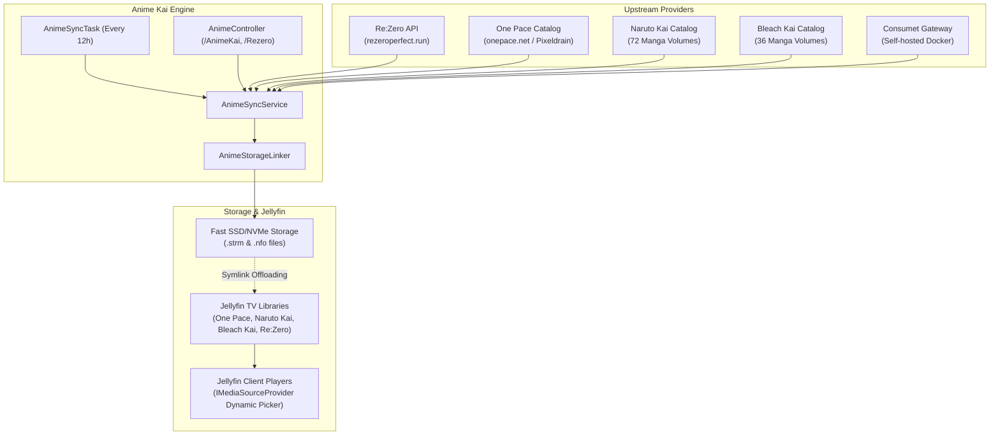

<div align="center">

# ⛩️ Jellyfin Anime Kai & Fan-Edits Plugin (`Jellyfin.Plugin.AnimeKai`)

**Universal streaming, metadata synchronization, and in-player audio/version switcher for Anime Fan-Edits & Direct HLS Streams in Jellyfin.**

[](https://dotnet.microsoft.com/)
[](https://jellyfin.org/)
[](README.md#-100-direct-tlshttps--zero-torrent-policy)
[](LICENSE)
[](https://github.com/FaserF/rezero-jellyfin/releases)

*Watch the acclaimed manga-accurate and fan-edited cuts of your favorite anime directly in Jellyfin with **zero-byte `.strm` direct playback**, **rich `.nfo` metadata**, **Intro Skipper segment markers**, and an **automated background update engine**.*

</div>

---

## 🔒 100% Direct TLS/HTTPS & Zero-Torrent Policy

All streaming pointers (`.strm`) and downloads strictly use **direct, private 1:1 client HTTPS connections** to official content distribution points (Cloudflare-fronted CDNs, Pixeldrain Direct API, self-hosted Consumet HLS Gateways).
- **Zero BitTorrent / P2P Swarms**: No torrent protocols, no DHT querying, and no background upload/seeding.
- **Zero Public IP Leakage**: Eliminates copyright strike and legal exposure common in public peer-to-peer swarms.
- **Instant Playback**: Video files stream directly into Jellyfin player clients without saturating server NVMe or local disk space.

---

## 🌟 Supported Providers

| Provider | ID | Description | Primary Sources & Format |
|---|---|---|---|
| **Re:Zero - The Perfect Run** | `rezero` | Chronological narrative fan re-cut removing Subaru's deaths/loops. Seamless arcs 1–6. | Fast Adaptive HLS Master (`index.m3u8`) & Direct 1080p MP4 |
| **One Pace** | `onepace` | Definitive manga-accurate cut of One Piece (Seasons 1..34 matching arcs). Eliminates 45%+ filler and pacing bloat. | Official Pixeldrain Direct HTTPS API (`1080p` / `720p`, Sub / Dub) |
| **Naruto Kai** | `narutokai` | 72 feature-length volume episodes matching Masashi Kishimoto's manga Volumes 1–72 (Chapters 1–700). Zero filler. | Direct HTTPS Stream Pointers & NFO Chapters |
| **Bleach Kai** | `bleachkai` | 36 feature-length volume episodes matching Tite Kubo's manga (Chapters 1–686). Omit all non-canon filler arcs (Bount, Amagai, Zanpakuto Rebellion, Regai). | Direct HTTPS Stream Pointers & NFO Chapters |
| **Consumet HLS Gateway** | `consumet` | Dynamic on-demand HLS scraper gateway for custom anime titles via self-hosted Consumet container. | HLS `.m3u8` multi-quality streams & WebVTT subtitles |

---

## 🏗️ System Architecture



---

## ⚙️ Configuration Reference

On a fresh install, all external providers default to `false` until enabled by the administrator in the Jellyfin Dashboard.

### Global Settings
| Setting | Type | Default | Description |
|---|---|---|---|
| `OfferAllQualitiesInPlayer` | `bool` | `true` | Injects alternate streams (HLS, dubs, clean subs) into player menus. |
| `EnableAutoSync` | `bool` | `true` | Background task checks for new releases periodically. |
| `SyncIntervalHours` | `int` | `12` | Frequency of background synchronization (1–168 hours). |
| `EnableSymlink` | `bool` | `true` | Uses fast local SSD for files and symlinks into library folders. |
| `DedicatedStoragePath` | `string` | `""` | Directory for physical stream files (blank = auto-detect). |

### Provider: Re:Zero - The Perfect Run
| Setting | Type | Default | Description |
|---|---|---|---|
| `EnableRezero` | `bool` | `false` | Enables Re:Zero - The Perfect Run synchronization. |
| `IntegrationMode` | `string` | `"SpecialSeason"` | `"SpecialSeason"` (Season 00 in existing show) or `"StandaloneSeries"`. |
| `SyncMode` | `string` | `"Stream"` | `"Stream"` (.strm pointers) or `"Download"` (HTTPS MP4 downloads). |
| `StreamFormat` | `string` | `"hls_auto"` | `"hls_auto"` (adaptive HLS master) or `"direct_mp4"`. |
| `PreferredLanguage` | `string` | `"jp"` | `"jp"` (Japanese original) or `"en"` (English dub). |
| `PreferredCaptions` | `string` | `"cc"` | `"cc"` (burned-in CC) or `"clean"` (no hardsubs). |

### Provider: One Pace
| Setting | Type | Default | Description |
|---|---|---|---|
| `EnableOnePace` | `bool` | `false` | Enables One Pace synchronization. |
| `OnePaceIntegrationMode` | `string` | `"StandaloneSeries"` | `"StandaloneSeries"` (Seasons 1..34) or `"SpecialSeason"`. |
| `OnePaceTargetLibraryPath`| `string` | `""` | Destination anime library folder (blank = auto-detect). |
| `OnePacePreferredQuality` | `int` | `1080` | Preferred stream quality (`1080`, `720`). |
| `OnePaceLanguage` | `string` | `"sub"` | `"sub"` (Japanese + English Subtitles) or `"dub"`. |
| `OnePacePixeldrainApiKey` | `string` | `""` | Optional Pixeldrain Pro API key for higher rate limits. |

### Provider: Naruto Kai & Bleach Kai
| Setting | Type | Default | Description |
|---|---|---|---|
| `EnableNarutoKai` | `bool` | `false` | Enables 72-volume Naruto Kai synchronization. |
| `NarutoKaiTargetLibraryPath` | `string` | `""` | Destination anime library folder. |
| `NarutoKaiLanguage` | `string` | `"sub"` | `"sub"` (Japanese + Subs) or `"dub"`. |
| `EnableBleachKai` | `bool` | `false` | Enables 36-volume Bleach Kai synchronization. |
| `BleachKaiTargetLibraryPath` | `string` | `""` | Destination anime library folder. |
| `BleachKaiLanguage` | `string` | `"sub"` | `"sub"` (Japanese + Subs) or `"dub"`. |

### Provider: Consumet HLS Gateway
| Setting | Type | Default | Description |
|---|---|---|---|
| `EnableConsumet` | `bool` | `false` | Enables on-demand scraping via Consumet container. |
| `ConsumetApiUrl` | `string` | `"http://127.0.0.1:3000"` | Base URL to self-hosted Consumet instance. |
| `ConsumetProvider` | `string` | `"gogoanime"` | Scraper provider (`"gogoanime"`, `"zoro"`, `"animepahe"`). |
| `ConsumetSubscribedShows` | `string` | `""` | Comma-separated anime slugs (e.g. `"steinsgate, chainsaw-man"`). |

---

## 📡 REST API & Backward Compatibility

The plugin exposes full REST endpoints under `/AnimeKai/*` and maintains 100% backward compatibility with legacy `/Rezero/*` callers:
- **`GET /AnimeKai/Status`** (or `/Rezero/Status`): Returns overall health, active providers, and episode counts.
- **`GET /AnimeKai/Providers`**: Returns the list of registered stream providers and their current status.
- **`POST /AnimeKai/Sync`** (or `/Rezero/Sync`): Triggers immediate multi-provider synchronization (supports optional `?provider=onepace` parameter).
- **`GET /AnimeKai/Updates`** (or `/Rezero/Updates`): Fetches live upstream changelogs.

---

## 🛠️ Local Build & Development

Run the automated local test and build runner:
```powershell
./build-local.ps1
```

Or run via the .NET 10 SDK:
```bash
dotnet restore
dotnet build -c Release
dotnet test
```

---

## 📄 License & Sponsors

Licensed under the [MIT License](LICENSE).

Maintained by **[@FaserF](https://github.com/FaserF)**.
